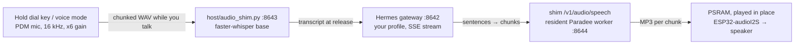

# Chirp — a voice terminal for small ESP32 devices

Chirp turns a LilyGO **T-Embed CC1101 Plus** or a LilyGO **T-Deck** (both
ESP32-S3) into a push-to-talk voice terminal. Hold the talk key, speak, and
the answer comes out of the speaker while the conversation scrolls on the
screen. You choose who answers when you set the device up:

| | **Venice** (cloud) | **Hermes** (your own machine) |
|---|---|---|
| Who answers | Venice's hosted chat, speech-to-text and voice models, over HTTPS | your own [Hermes Agent](https://hermes-agent.nousresearch.com/docs/getting-started/installation) profile; listening (whisper) and the voice (Paradee) run on your machine |
| You need | a Venice account with API credit, and one API key | a Linux machine on the same WiFi that runs Hermes and this repo's speech server |
| Cost | Venice charges credit for every answer (listening, thinking and speaking are separate calls) | whatever your Hermes model provider charges; the speech parts are free and local |
| The device talks to | `api.venice.ai` over the internet | only your own network, plain HTTP |
| Persona | fixed: *Chirper*, a friendly companion for kids (built into the firmware) | your profile's persona (`SOUL.md`), tools and memory |
| Choose it when | you want the shortest setup and have no always-on computer | you want your own agent and private speech |

## Quick start

This is the whole path from a fresh clone to a first spoken answer. It works
for either board and either route; steps that differ say so. Everything
below the quick start is reference.

### What you need

Always:

- A **T-Embed CC1101 Plus** or a **T-Deck**, and a USB-C cable that carries
  data (charge-only cables do not work).
- A computer to flash it once. Chrome or Edge on a desktop for the T-Embed's
  browser installer; for the T-Deck (or if you prefer building yourself) Git
  and [PlatformIO](https://platformio.org/install/cli) (`pip install
  platformio`; CI builds with Python 3.11, so use 3.10–3.12 if your system
  Python is much newer). The first build downloads the ESP32 toolchain and
  libraries, so it needs internet and a few minutes.
- A phone (or any WiFi device with a browser) for the first setup, and a
  **2.4 GHz** WiFi network the device can join. A network that needs a
  browser sign-in page (hotel, campus) will not work.
- Access to this private repository (the owner adds you as a collaborator on
  GitHub) and the `tdeck-venice` branch: that is where the T-Deck and Venice
  support live.

For **Venice**: a Venice account with API credit, and an API key made on its
[API settings page](https://docs.venice.ai/guides/getting-started/generating-api-key)
(`venice.ai/settings/api`). Make one just for this device so you can revoke
it alone. The device sends your voice and text to Venice over HTTPS and
needs working internet.

For **Hermes**: a Linux machine on the same network with

- Hermes Agent [installed](https://hermes-agent.nousresearch.com/docs/getting-started/installation)
  and a model provider configured (`hermes setup`);
- Hermes' [API server enabled](https://hermes-agent.nousresearch.com/docs/user-guide/features/api-server)
  (`API_SERVER_ENABLED=true` in `~/.hermes/.env`) and the gateway running
  (`hermes gateway start`); `pair.py` also needs
  `hermes config set gateway.multiplex_profiles true` and tells you if it is off;
- `systemd` user services (`pair.py` and the speech-service installer use
  `systemctl --user`), Python 3.10–3.12 and room for two small local speech
  models (`pair.py` says what it downloads before it does);
- the ports `8642` (Hermes) and `8643` (this repo's speech server) reachable
  from the device's WiFi, and ideally a fixed address for the machine (a
  DHCP reservation): the device stores that address.

`host/pair.py`, `host/provision.py` and the speech-server installer are
Linux-only. Without Linux, use Venice, or run Hermes on a Linux machine.

### 1. Get the code

```sh
git clone --branch tdeck-venice <repo-url> chirp-esp32-firmware
cd chirp-esp32-firmware
```

For the Hermes route, do this on the Hermes machine.

### 2. Flash the firmware

**T-Embed, from the browser (no build tools).** Get the `flasher` artifact
of the latest **firmware-release** run (GitHub → Actions; the owner can
start one, or send you the zip), unpack it and serve it on your desktop:

```sh
unzip flasher.zip -d flasher && cd flasher && python3 -m http.server   # open http://localhost:8000
```

In Chrome or Edge, plug the device in, click **Install** and pick its port.
If no port shows up, hold **BOOT** while plugging the cable in. Leave **Erase
device** unticked: erasing wipes the saved settings (a new device does not
need it). The installer carries **T-Embed images only**, and its builds do
not update over WiFi (see *Updating*).

**Either board, with PlatformIO.** Always name the board; without `-e`,
`upload` flashes every board's image in turn:

```sh
pio run -d firmware -e t-embed-cc1101 -t upload     # T-Embed CC1101 Plus
pio run -d firmware -e t-deck -t upload             # T-Deck
```

The port is found automatically (add `--upload-port /dev/ttyACM1` if not;
the name drifts after a reset). If the upload cannot connect, put the board
in download mode: T-Embed, hold **BOOT** while plugging the cable in;
T-Deck, hold the trackball click, tap the board's reset button, release (the
screen stays dark).

**T-Deck that will not flash over serial.** On the owner's unit the ESP32-S3
ROM loader never answered `esptool` or Web Serial, in any download mode. If
yours behaves the same, flash over USB-JTAG with Espressif's `openocd-esp32`
instead: the exact command and the udev rule it needs are in step 4 of
[Flashing the device](AGENTS.md#flashing-the-device). The four images come
from the build (`firmware/.pio/build/t-deck/bootloader.bin`, `partitions.bin`,
`firmware.bin`, plus `boot_app0.bin` from PlatformIO's
`framework-arduinoespressif32/tools/partitions/`).

After flashing, a device with no settings restarts into its **setup
screen**.

### 3. First setup on the phone

A device with no saved settings (new, or erased) starts its own WiFi
network instead of the app. The screen shows the network name
`Chirp-XXXX`, a one-time 12-character password and a QR code:

Hermes route with the device plugged into the Hermes machine: skip the phone
and go to **Hermes** below; `pair.py` does the whole setup over the cable.

1. On the phone, join `Chirp-XXXX`: scan the screen's QR code (it joins the
   network for you) or type the password. If the phone warns that the
   network has no internet, stay connected.
2. The setup page opens by itself. If it does not, open any plain `http://`
   address in the phone's browser (not `https://`): every address lands on
   the page.
3. **WiFi:** pick your network from the nearby list (or type its name), type
   the password; tick *Open network* if it has none.
4. **Backend:** choose **Venice** or **Hermes on my network**, then follow
   the matching part below.
5. Tap **Save and restart** (the page says *Saved*; the device screen says
   *All set! Restarting*). Reconnect the phone to its usual WiFi. The device
   joins your network and checks its backend ("Checking Venice" or "Checking
   Hermes"); the chat screen with the talk hint means it is ready.

The setup network stays open until something is saved. Once the device has
settings, a setup session you start from the menu ends by itself after 10
minutes without a phone (15 at most).

**Venice.** Paste the Venice API key into *Venice API key* (tick *Show
password and key* to check what you typed). Leave *Venice host* alone. Hermes
fields vanish; nothing else is needed, and no computer has to stay on.

**Hermes.** First pair the device from the Hermes machine; it checks the
gateway, makes (or links) the profile and its key, installs the speech
server if needed and sends it all to the device:

```sh
python3 host/pair.py                 # device plugged into this machine (recommended)
python3 host/pair.py --no-usb        # prints a QR code instead; scan it with the phone
                                     #   while the phone is on the Chirp-XXXX network
```

It asks before changing anything, and asks for the WiFi name and password
when it hands over by USB (so you do not need the phone page). With
`--no-usb`, scan the code with the phone already on `Chirp-XXXX`, pick your
home WiFi on the page, and save. The steps, the profile choice and the
character look are in [Pairing with Hermes in detail](#pairing-with-hermes-in-detail);
every phone-page field is in [Setting up from the phone alone](#setting-up-from-the-phone-alone).

**Without a phone (USB).** Copy `firmware/device.env.example` to
`firmware/device.env` (git-ignored), fill in the values for one route
(comments in the file say which), plug the device in and run
`python3 host/provision.py [--port /dev/ttyACM0]`. It sends the settings over
serial, never prints them, and the device restarts. On Linux your user must be
allowed to use the serial port (group `dialout` on most distributions).

**WiFi networks.** The device keeps up to 5 and joins the strongest saved one
in range, at boot and whenever it reconnects. To add one, open **Setup → Set
up on phone** and add it on the page (the saved ones are listed; the 6th
pushes out the one joined longest ago). To remove one, tick *Forget* next to
it on that page, or send `settings {"forgetWifi":"NETWORK NAME"}` over
serial (`pio device monitor -d firmware -e <board>`, 115200 baud).

### 4. Use it

Wait for the chat screen, then hold the talk key, ask something, release.
The answer is spoken as it arrives. A Venice answer is three separate calls
(listening, thinking, speaking), each charged by Venice.

| Action | T-Embed CC1101 Plus | T-Deck |
|---|---|---|
| Talk (hold, release to ask; press while it speaks to interrupt) | hold the encoder (dial) key | hold the **mic key** on the keyboard |
| Hands-free voice mode on/off | double-tap the encoder key | double-tap the mic key |
| Menu: open, next tab, back to chat | tap the side key (5 taps reach **Setup**); a tap while it is thinking stops the turn | click the trackball (5 clicks reach **Setup**); **Backspace** leaves the menu |
| Select / scroll | turn the dial | roll the ball up/down (sideways does nothing) |
| Activate the selected row | press the encoder key | **Enter** |
| Volume (0–21) | hold the side key 1.5 s, turn the dial | hold the ball click, roll |
| Switch character view ↔ chat view | hold the encoder key, tap the side key | hold the mic key, click the ball |
| Type a question | not available | type, **Enter** sends |

The menu tabs are **Chats → Theme → Chirper → Text → Setup**. Setup is where
you switch agent (Hermes), pick the voice (Venice), reopen the phone setup
(*Set up on phone*) or *Restart*. The full behaviour of every tab and view
is in [Using it](#using-it) (written for the T-Embed's controls; the table
above maps them to the T-Deck's).

In **Venice** mode the Setup tab has a **Voice** button: press it to step
through Sky, Heart and Bella; Chirp says "Hi, I'm Chirp!" in the new voice
and the choice is saved. The Chats tab only offers *+ New chat* (Venice
keeps no chats server-side; the device remembers the last 12 exchanges of the
current chat in memory, and a new chat or a restart empties them).

### 5. Updating

Flash again the same way (browser installer or `pio … -t upload`) and **do
not erase**: WiFi networks, keys, agents, the Venice key, voice, theme and
font all live in a separate settings partition that an upload keeps. A device
that was set up with an older firmware may forget its WiFi once when it first
runs this one (it asks again in setup mode; keys and agents are kept).

WiFi updates (a signed build pulled from the speech server at boot) exist
only on the Hermes route, and only for builds you sign and publish yourself:
see *Updates over WiFi* under [Development](#development). Venice devices,
browser-installer images and unsigned builds update over USB.

### 6. Troubleshooting

| Symptom | Fix |
|---|---|
| No port in the installer / `pio` cannot connect | Use a data cable. Hold **BOOT** (T-Deck: the trackball click) while plugging in or tapping reset. On Linux, stop `ModemManager` (`sudo systemctl stop ModemManager`) and add your user to `dialout`. T-Deck still silent: JTAG route in step 2. |
| Nothing happens after flashing | Unplug and replug the cable. A device with no settings shows the setup screen (step 3). |
| No `Chirp-XXXX` network on the phone | Look at the device screen: it shows the name and password. 2.4 GHz only; move closer. The phone may call it "no internet": stay connected. |
| Setup page does not open | Open any plain `http://` address in the browser (not `https://`). |
| "Refused: open the setup page again and resubmit" | The page was left open across a restart or a second setup session: reload it and save again. |
| WiFi failed at boot | Wrong password, 5 GHz-only network, none in range, or a network with a sign-in page. Open **Setup → Set up on phone** (the screen says how) and fix or add a network. |
| Venice: *Bad API key* | The key is wrong or revoked: enter it again on the phone page (a blank key box keeps the stored one). |
| Venice: *Out of credit* | Add credit on your Venice account. |
| Venice: *Key not allowed* | The key has an IP allow-list that excludes your network; change it in Venice's API settings. |
| Venice: *Rate limited* | Wait a moment and ask again. |
| Venice: *Backend unreachable / not answering* | No internet, or Venice is down. |
| Hermes: unreachable, speech server unreachable, key rejected, profile not found | See the boot-check table under [Using it](#using-it); `python3 host/pair.py` re-checks everything. A changed address for the Hermes machine needs a re-pair. |
| Want a clean start | A full erase (browser installer: tick *Erase device*; `pio run -d firmware -e <board> -t erase`) wipes every setting and returns the device to its setup screen. |
| Reporting a problem | `pio device monitor -d firmware -e <board>` (115200 baud) shows the boot log (`[WiFi]`, `[SelfTest]`, `[Settings]`; never the values). |

### 7. Known issues

- **Venice: internal memory dips after an answer.** After a Venice answer the
  device's free internal heap falls lower than in Hermes mode (the heap-floor
  check of `host/smoke.py` is the measure). If a Venice device ever restarts
  by itself mid-answer, send the serial log.
- **T-Deck: thin vertical flashes.** Some menu repaints in the *Rosé Pine*
  dark theme show one-refresh vertical flashes. It is cosmetic; another theme
  may avoid it.
- **T-Deck: flashing may need JTAG** (step 2).
- **Venice mode:** the persona is fixed, there are no server-side chats, and
  there are no WiFi updates.

More limits that apply to both routes are under [Known limits](#known-limits).

## Pairing with Hermes in detail

On the Hermes machine, with the device still on USB:

```sh
python3 host/pair.py
```

It walks through everything the device needs and asks before changing
anything:

1. Checks that Hermes and its gateway are running.
2. Asks which Hermes profile this agent is — link an existing one, or
   create a new one:
   - **Link** (`--link NAME`, `default` for the root profile): the profile
     keeps its persona, model and history, and Chirp joins its conversations.
   - **Create** (`--create NAME`): fresh with your current model, or a copy
     of another profile's setup (`--clone-from NAME`: config, tools, skills,
     persona — not its history). It offers a starter persona written for
     speech (short spoken answers, no lists or links).

   Either way the persona is the profile's `SOUL.md` — edit it to change who
   answers.
   After the persona is settled, `pair.py` proposes a **character look** for
   the agent (see *Character look* below): it reads the profile's `SOUL.md`
   on this machine, never prints or sends it, and asks whether to accept,
   reroll or keep the default.
3. Gives the profile an API key: a linked profile keeps its own; a new one
   always gets a fresh key, even when copied from another profile.
4. Makes sure the speech server runs: whisper `base` for listening and
   Paradee for the voice, both local. It explains and asks before installing.
5. Checks the gateway answers on your LAN address. If it only listens on the
   machine itself, it explains what opening it means (every profile's API
   becomes reachable on your network, each behind its own key) and asks.
6. Sends the agent to the device over USB and waits for the device's own
   check to report ready. The first time you also type your WiFi name and
   password; later runs can leave the WiFi blank (the device keeps its saved
   networks) or add another one.

### Character look

In character mode each agent is drawn as a pixel-art character (see *Using
it*). By default it comes from the profile name alone. `pair.py` can refine
it from the persona: it matches the profile name and `SOUL.md` against a short
keyword table (`host/avatar_look.py`, one line per rule: kitchen → toque and
whisk, salon → scissors and bow, code → headphones and glasses, and so on),
describes the result in a sentence ("a Tangerine character with no ears,
wearing a toque and holding a whisk, bouncy"), and asks:

```
Use this look? [a]ccept / [r]eroll / [k]eep the default:
```

*Reroll* keeps what the persona decided and redraws the rest (the same number
always gives the same look); *keep* clears any look the device had. The text
of `SOUL.md` stays on this machine: only twelve trait numbers are sent (in the
`look` member of the serial settings line or the pairing QR code, hex, one
byte per trait, `ff` = keep the seeded one) and the device stores them with
the agent's key. `--look` accepts the proposal without asking, `--look
hat=toque,palette=Teal` edits it first, `--look none` clears it; with `--yes`
and no `--look` the device's character is left alone.

On the device, *Original* in the Chirper tab is this look (or the seeded
character when there is none). A character you keep in the Chirper tab wins
over it, for that agent.

### More than one agent

A device holds up to 4 agents (Hermes profiles, each with its own key). Every
`pair.py` run adds one, or replaces the key of one it already has, and makes
it the one in use; the others stay. Switch on the device: open the **Setup** tab
(five side-key taps; T-Deck: five ball clicks), select *Switch to NAME* (dial or
ball) and press the dial key (T-Deck: Enter); the device saves and restarts in
about 6 s. Each agent resumes its own last conversation.
Remove one with `python3 host/pair.py --forget NAME` (USB) or its *remove*
box on the phone setup page; the profile itself stays on Hermes. All agents
live on one Hermes host: pointing the device at a different host (including
a `pair.py` run from another machine, or the same machine under another
name or address) replaces them with the agent added in that step, so a key
never reaches a gateway that didn't issue it.

The USB handoff is the recommended one: no key crosses WiFi or a screen.

No USB, or prefer the phone? `python3 host/pair.py --no-usb` shows a QR code
instead (it needs `qrencode`; without it the setup URL is written to a
private file under `~/.config/chirp/` and only the path is printed): join the
`Chirp-XXXX` network shown on the device with your phone, scan the code, and
pick your home WiFi on the page that opens. The code carries the profile's API
key, so don't share it or screenshot it. The pairing code sits in the URL
fragment (`#pair=`): it never reaches the device as a request and the page
removes it from the address bar after reading it.

### Setting up from the phone alone

Join `Chirp-XXXX` (scan the device's on-screen code, which joins the network,
or type its password); the setup page opens by itself, or at any plain
`http://` address. The quick start's [first setup](#3-first-setup-on-the-phone)
walks through it; these are all the fields:

| Field | |
|---|---|
| WiFi: saved networks | the networks Chirp remembers (up to 5, names only, never passwords): tick *Forget* to remove one. Chirp joins the strongest saved network in range, at boot and whenever it reconnects, so walking from one to another just works |
| WiFi: add a network / password | adds a network to that list (blank name = add none; nearby networks are offered; tick *Open network* for one without a password; a name already saved is edited, a blank password keeps its saved one). The 6th network pushes out the one joined longest ago |
| Backend | **Hermes on my network** or **Venice** (cloud). Switching keeps the other mode's settings stored |
| Venice API key | Venice only. Write-only: a blank box keeps the stored key |
| Venice host (advanced) | Venice only; blank = `api.venice.ai:443`. A different host drops the stored key (a key belongs to the host that issued it) |
| Hermes host | Hermes only: your Hermes machine as `host` or `host:port` (default port 8642) |
| Agents | Hermes only: the agents already on the device: pick the one to *use*, tick *remove* to drop one |
| Add an agent: profile name + API key | Hermes only: a profile that **already exists** on Hermes and its `API_SERVER_KEY` (in `~/.hermes/profiles/<name>/.env`; the default profile's is in `~/.hermes/.env`). Blank name = the default profile. Typing a new name does not create a profile: `host/pair.py --create NAME` does, and sends it here |
| Audio shim host | Hermes only; optional; blank = the Hermes host, port 8643 |

Settings are stored on the device and survive firmware updates. To change
them later: open the **Setup** tab (five side-key taps on the T-Embed, five
ball clicks on the T-Deck) and pick *Set up on phone*. Saved values are filled
in; the password and keys are never shown again, and leaving the password or
a key blank keeps it. The side key (T-Deck: Backspace) leaves setup without
changes.

## Using it

These are the T-Embed's controls. On the T-Deck the mic key is the dial key,
the ball click is the side key and rolling the ball is turning the dial; the
[quick start's table](#4-use-it) lists them side by side.

| Input | Action |
|---|---|
| Dial key (hold) | Talk; release to ask. Press while it speaks to interrupt and ask again. The mic starts on the press, but the screen shows Listening only once you have held it 0.5 s, so taps never flash it; a press shorter than 0.3 s is never sent as speech |
| Dial key (double-tap) | Hands-free voice mode on/off (second press within 0.4 s): turns open when you speak and close after 2 s of silence; leaves after 3 min of quiet |
| Dial key held + side key tap | Switch between the character view and the chat (transcript) view, in any state, keeping your place (the newest if you were following it); what the dial press started recording is dropped |
| Side key (tap) | Steps through the screens: chat → **Chats** (new chat pinned on top, then recent chats to resume; Venice keeps only *+ New chat*) → **Theme** → **Chirper** → **Text** → **Setup** → chat, so Setup is five taps away. While it's thinking: stop the turn |
| Side key (hold) | Volume mode for 1.5 s; the dial adjusts (0–21, 21 = unity gain) |
| Dial (turn) | Scroll the chat: 4 / 8 / 16 lines per click by spin speed (the bubble column in character mode: 2 / 4 / 8). In the menu: select (1 row per click, 2 when spun) |

The **chirp! logo**, *Perch* (the hand-pixelled wordmark with a tiny chick for
the dot of the i, drawn like the characters: a deep outline all the way round,
and on dark themes a soft glow of its rim tint just outside it), is the boot splash, with the boot messages under
it, and sits under the Setup tab's buttons. The empty chat (before the first
turn, and after *+ New chat*) has no bottom line: the logo is drawn as large
as fits, centred with the two hints (hold to talk, double-tap for voice mode);
it moves up only when something starts (you talk, or voice mode waits for
you). Errors still come up on the bottom line.
The setup page a phone opens in setup mode carries the logo above its
heading, on a light band, scaled up with crisp pixels. That image is
`firmware/include/logo_web.h`, a 4-bit PNG baked from `logo.h` by
`python3 firmware/tools/logo_web.py` (byte-for-byte reproducible; the host
tests fail while the two disagree, and `--check` verifies it by hand), so
`logo.h` stays the one source of the art.
`python3 firmware/tools/logo_preview.py DIR` draws the logo on all twelve theme
backgrounds with the firmware's own `logo.h` (it compiles
`firmware/test/host/logo_preview.cpp`; needs g++ and Pillow). With `--art FILE`
it draws a design from a text file of art rows instead, and `--compare` lays
the shipped logo and each `--art` side by side on all themes, plus mock boot
splashes and empty chat screens. Alternative directions to choose from live in
`firmware/tools/logo_options/`.

The **Theme** tab lists the six themes alphabetically (Catppuccin, Everforest,
Gruvbox, Rosé Pine, Solarized, Tokyo Night). Turning the dial switches the screen to
each as you pass it; the one you stop on stays (it is remembered). The dial
key flips the theme between dark and light; light reads better outdoors.

The **Chirper** tab shows the agent's character large and animating. Turn the
dial to browse (counter-clockwise = next, a quick spin jumps ten): first the agent's
kept look (only while it has one), then *Original*, then the numbered
characters `#1` to `#999`, generated on the spot and none stored. Press the
dial key to keep the one on screen for this agent: the device stores the
character itself (its trait record), not a number, so a kept look is drawn
exactly the same after a firmware update. Keeping *Original* again clears the
kept look. Leaving the tab without pressing keeps the character you had:
browsing is a preview. The `#n` numbers are only a way to explore the current
generator and may show different characters after a firmware update.
*Original* is the agent's own: its persona look from `pair.py` when it has
one, else the character drawn from its profile name, always derived by the
current generator. A variant number kept by a build that stored numbers is not
carried over: that agent shows its Original until you keep a character.

The **Text** tab lists the four fonts, each row drawn in its own face:
Atkinson Hyperlegible (the default, designed for legibility), Inter, Paper Mono
and Terminus (a pixel font that suits the character mode: it is drawn from its
own hand-made 8x14, 8x16 and 10x20 bitmaps, so every size is pixel-exact). Turning the
dial switches the whole UI to each as you pass it; the dial key cycles the size
S → M → L (the status line names the next one). Both are remembered. Line
height, menu rows and the status strip follow the size; the setup-portal screen
keeps its own fixed font so it always fits beside the QR code.

The **Setup** tab's actions are drawn as buttons: the agents (*NAME (in use)*,
*Switch to NAME* for the others, or *NAME (only agent)* when there is one),
*View: Character* / *View: Chat*, in Venice mode *Voice: NAME* (each press
steps Sky → Heart → Bella and speaks "Hi, I'm Chirp!" in the new voice; the
choice is saved), *Set up on phone* (restarts into the
setup hotspot and QR code) and *Restart* (reboots to the boot screen; the
settings, the chat and the kept look stay). Under them sits the chirp! logo, then below the
dotted rule, as plain rows: the firmware version, WiFi (the joined network and its
signal, or how many are saved while offline), address, Hermes host,
speech server and battery. The dial scrolls through every row, so at the
larger text sizes the info rows come into view too (the dial key does nothing
on them). The **Chats** tab's *+ New chat* is a button the same way. Every
list that holds more rows than fit (Chats, Theme, Text, Setup) shows a
scrollbar at its right edge.

**View: Character** (dial key on the View row, or the dial key held with a
side-key tap anywhere; applies at once and is
remembered) replaces the scrolling chat with a pixel-art character for the
agent in use: every agent gets its own, drawn from its profile name (or the
look kept in the Chirper tab) in its own colours, the same on every theme.
Only the background, and with it the glow round the character (on dark themes
a one-pixel ring of its bright rim tint at half strength just outside the deep
outline; none on light themes), follows the theme. The outline is the same on
every theme.
The view takes the whole screen: the character on the left, centred, and the
chat on the right as comic speech bubbles, each as tall as its text: the
agent's on the left edge, yours on the right with a tail, tinted in the
theme's accent. The bubbles hold the whole stored chat (the same as the chat
view), oldest at the top. The
character idles (breathing, blinking, glancing), perks up while you talk with
soft ripple rings lighting one after another toward its head, looks up
while Hermes works (the chat shows its bubble with dots lighting in turn until
the answer starts), moves its mouth with the answer audio while little sparks
and notes rise beside it and fade, shakes with crossed eyes when a turn fails, and
falls asleep when the screen dims. Short one-shot expressions react to events:
a start (it jumps, with an exclamation mark) when you begin to talk, a happy
bounce with sparkles when the answer starts, and a puzzled look with a
question mark when nothing was heard. While you talk, a bubble of yours at the
bottom shows the level bars with the time under them ("Listening 4s"; in voice
mode "Closing 2s" counts down the silence that ends the turn). While voice
mode waits for you, that bubble shows three dots lighting in turn, with
"Double-tap to exit" under it (the chat view's bottom line says it too). While it speaks,
a level meter in the same style runs along the bottom of the answer's bubble.
The column follows the answer as it streams, and while it is read out it
scrolls along with the speech, keeping the sentence being spoken near the top. The dial scrolls the whole column (2 / 4 / 8 lines per
click by spin speed) and the next turn snaps back to the newest. There is no
bottom line in this view: it comes up over the bottom only for an error or
while you change the volume or a firmware update runs, and goes with the next
message. **View: Chat** (the default) is the scrolling chat: the
agent's lines on the left, yours on the right, a rule between them. While
you talk, its newest row is your level bars (on your side, under a rule,
centred down to the bottom line, after the same 0.5 s); while voice mode waits
for you, three dots there; and while the agent speaks, its green wave a blank
line under the answer.

Characters are put together from 16 head shapes, 8 torsos, 5 kinds of feet
and 5 of arms, 19 ears, horns and antennae, 14 eye styles, 13 mouths, 23 hats,
19 accessories (worn or held), 14 coat patterns, 30 colour palettes and 7
temperaments (how it blinks, glances and fidgets: a curious one looks about,
a drowsy one yawns, a jumpy one shivers). The vocabularies only ever grow at
the end, so an existing index keeps its meaning: persona looks and kept looks
stay valid. `python3 firmware/tools/avatar_preview.py DIR` draws contact
sheets, one sheet per part vocabulary and per-state GIFs with the firmware's
own `avatar.h` (it compiles `firmware/test/host/avatar_preview.cpp`; needs
g++ and Pillow).

The Chats list loads in the background, so the side key moves on at once
even when Hermes is slow.

The bottom line is status (Listening / Transcribing / Thinking; while the agent speaks the chat's wave row shows it instead).
While a turn works, a bright band sweeps through the grey status word; the
view chord still switches the view, and a side-key tap stops the turn ("Stopped",
no answer). If Hermes accepts the question but sends nothing for 90 s (its
model is down, say), the turn ends as "Backend not answering". The chat stays
pinned to the newest turn; scrolling unpins it and the next question re-pins
it.

At boot (and after waking from sleep) the device checks its connections:
the bottom line says *Checking Venice* or *Checking Hermes*, then
*Connected to …* for a few seconds when everything answers, or names the
first problem it finds (the conversations menu does the same). The check
gives up after about 15 s at most:

| Message | Fix |
|---|---|
| WiFi failed (T-Embed: "side key 5x = Setup"; T-Deck: "Click 5x = Setup") | no saved network joined (wrong name or password, or none in range): Setup tab (five taps or clicks away), *Set up on phone* |
| Hermes key rejected | wrong API key for the agent: run `host/pair.py` again, or Setup tab, *Set up on phone* |
| Hermes profile not found | the profile name doesn't exist on the gateway |
| Hermes unreachable | the gateway isn't running or not reachable on the LAN (`host/pair.py` checks) |
| Speech server unreachable | the speech server isn't running: `systemctl --user status hermes-audio-shim` |
| Venice: *Bad API key*, *Out of credit*, *Key not allowed*, *Rate limited* | as in [Troubleshooting](#6-troubleshooting) |
| Venice unreachable | no internet, or Venice is down: check the WiFi has internet access |
| Venice error | Venice answered with an unexpected error: try again later |

A turn that fails afterwards says why on the bottom line: *Bad API key*,
*Out of credit*, *Key not allowed* or *Rate limited* (Venice
only; see [Troubleshooting](#6-troubleshooting)), *Backend not answering*
(nothing arrived for 90 s) or *Backend unreachable*.

**On battery** the screen dims after 60 s idle, turns off at 3 min, the device
light-sleeps at 10 min (a key wakes it with the chat intact) and deep-sleeps
at 2 h (a key reboots it). On USB the screen follows the same dim and off
timeline (any input wakes it) but the device never sleeps. The press that wakes a
dark screen only wakes it. The T-Deck has no charger chip: it counts as on USB
while a USB host is attached, so a charger-only plug counts as battery.

**Battery level** sits at the right end of the bottom line in the chat view
(and when the bottom line comes up over the character view; the menus leave
it out): a battery outline whose inner bar, at half strength, shows the
level, in the grey of the hints. There is no number there.
It turns the *Ok* colour on USB, with a bolt left of the outline while the
charger is working, and the *Err* colour below 15 % on battery (it clears at
18 % or when USB is plugged in). The Setup tab's *Battery* row gives the
percentage, the cell voltage and whether it is charging. The percentage is an estimate from the cell
voltage (read from the charger every 10 s and smoothed, so it moves a point at a
time and ignores load dips); a loud answer or a fresh unplug can make it step.
With the character screen on battery, the character slows to 4 frames a second
after 20 s without input or a turn (well before the screen dims) and returns to
full speed on the next key, turn or word.

## How a turn works



- **Speech recognition starts before you let go.** The capture streams to the
  shim while you talk; whisper re-decodes the growing buffer in the
  background, so the final transcript is ready about a second after release.
  If the stream drops, the device falls back to one upload.
- **Speech starts on the first sentence.** The answer streams from Hermes;
  the first sentence becomes the first chunk, the second chunk stays short
  (2+ sentences / 14+ words, closed at 30 words), later chunks grow (30+
  words, 80 max), and playback begins while Hermes is still generating. A
  chunk closes at the sentence where it is complete, so a burst of text
  never becomes one huge chunk. Measured with `host/latency.py`: audio starts
  about 1 s after Hermes' first word.
- **The voice is local and warm.** [Paradee](https://github.com/sahilmahendrakar/paradee)
  (8M-parameter distillation of Kokoro-82M, single voice `af_heart`) stays
  loaded in a resident worker: ~0.2 s per chunk.
- **Venice route.** The device calls Venice directly over HTTPS for each of
  the three steps: speech-to-text (Parakeet), the answer (a GLM chat model;
  the last 12 exchanges ride along on each request, since Venice keeps no
  state) and the voice (Kokoro: Sky, Heart or Bella). There is no shim, no
  gateway and no computer in the path. The model ids are pinned in
  `firmware/include/venice_policy.h` per firmware release.

## Development

**Speech server** on its own: `host/setup.sh --install-service` (venv, pinned
deps, models, secret hook, systemd unit), then
`curl http://localhost:8643/health`.

The shim listens on the LAN and bounds every request: a recording body is
capped (30 s of audio plus slack, 64 KB per chunk), speech input at 4096
characters, any socket read or write times out after 30 s, a whole body must
arrive within 60 s, and at most four POSTs run at once (the rest get 503).
`host/test_audio_shim.py` checks the limits offline.

**Firmware** (PlatformIO, `espressif32@6.13.0`; builds carry no settings or
secrets):

```sh
pio run -d firmware -e t-deck                                      # build (or -e t-embed-cc1101)
pio run -d firmware -e t-deck -t upload --upload-port /dev/ttyACM1 # flash (always name the board)
firmware/test/host/run.sh                                          # host tests
```

Read the flashing procedure in [AGENTS.md](AGENTS.md) before flashing — the
S3's native USB is easy to wedge. Settings live in the ESP32's NVS partition:
uploads keep them; a full flash erase or a partition-table change clears them.
CI (`.github/workflows/ci.yml`) runs the host tests, a firmware build and
`py_compile` over `host/*.py` on every push and pull request.

**Updates over WiFi** (Hermes route only: a Venice device has no speech server to ask): after each healthy boot (self-test passed) the device
asks the speech server for `/firmware/manifest.json`. The shim is not trusted:
every manifest is signed with an ECDSA P-256 key that only you hold, and a
device installs an image only when

1. the manifest is at most 512 bytes and has exactly the members `build`,
   `version`, `size`, `sha256`, `sig`;
2. `sig` verifies, over `chirp-ota-v1|<build>|<version>|<size>|<sha256>`,
   against the public key compiled into the firmware it is running;
3. `build` (unix seconds at build time) is higher than both the running
   image's build and the highest build it ever installed, so an old signed
   manifest cannot roll a device back (downgrades go over USB);
4. it is not the image whose install failed last (until the manifest changes
   or the device loses power);
5. the downloaded image fits the spare app slot, finishes within 120 s, and
   its SHA-256 matches the signed manifest — checked before the slot is
   activated.

A failed or corrupt download changes nothing, settings are never touched, and
USB stays the recovery path. A new image is marked good as soon as it joins
WiFi, so Hermes or the speech server being down never rolls a working image
back; an image that crashes first, or never joins WiFi, rolls back.

Set up signing once, then publish each build to every device on the network:

```sh
host/publish-firmware.py --init-key  # private key: ~/.config/chirp/ota-signing.pem (0600);
                                     # public key: firmware/ota_pub.pem (gitignored)
pio run -d firmware                  # embeds ota_pub.pem + a build number; FW_VERSION = git describe
# flash this build over USB once: devices only trust the key in the image they run
host/publish-firmware.py             # signs and publishes → ~/.local/share/chirp/firmware/
```

Back up the private key and never share it: losing it means re-flashing every
device over USB, and anyone holding it can push firmware to your devices. The
publisher refuses to run without it, and refuses an image that does not embed
its public half. A build made without `firmware/ota_pub.pem` (CI and release
builds, for example) still works but never updates over WiFi (`[OTA] no signing
key in this build; updates off`). The publisher needs the `cryptography`
package.

**Measuring:** `host/latency.py` drives text turns on a bench build and
reports when the first word, first chunk and first audio arrive (from the
firmware's `[Lat]` lines). `host/bench_stt.py` compares whisper models on
synthetic clips; `base` (the default) was fastest with equal accuracy.

**Smoke test after a bench flash:** `host/smoke.py` drives a bench build
(`PLATFORMIO_BUILD_FLAGS=-DBENCH_CMDS`) over USB serial and prints one
pass/fail table: boot health, the tab walk (chat > Chats > Theme > Chirper >
Text > Setup > chat), theme, chirper, font/size and screen-choice changes, a
`heap all` check in the transcript view (the settled heap after the run must
match the heap before it, within a tolerance; plus a low-watermark floor) and
a scan for crashes. It sets
volume 0, never asks Hermes unless you pass `--turn` (one text turn in a new
conversation), and with `--reboot` hard-resets the device and checks the
settings survived. It puts the device back to its starting theme, font, size,
view and kept look (the status line's `look=` field), even when a check fails. It needs `serial-watch.py`
running and the device idle on the chat screen. Exit status is non-zero on any
failure; `--json out.json` keeps the rows. Its parsing is covered offline by
`python3 host/test_smoke.py`.

```sh
host/smoke.py [--turn] [--reboot] [--json out.json]
```

**Releases:** pushing a `v*` tag runs `.github/workflows/firmware-release.yml`:
it builds the firmware (both boards), attaches the four **T-Embed** flash
images to the GitHub Release, and publishes a `flasher` artifact (T-Embed
installer page + images) for any HTTPS static host; the T-Deck is flashed
with PlatformIO. Locally, `python -m http.server` inside the unpacked artifact
works too (Web Serial needs HTTPS or localhost).

| Path | What |
|---|---|
| `firmware/` | Device firmware, one module per concern (map and execution contexts: `firmware/include/app.h`); pure logic host-tested by `firmware/test/host/run.sh` |
| `firmware/tools/make_font.py` | Generates the device fonts (`firmware/src/fonts/font_data.cpp`): four families x S/M/L from pinned upstream sources (`font-sources.txt`, SHA-256 checked), each under the SIL OFL 1.1 with its license beside the data; needs Pillow + fontTools |
| `flasher/` | Browser installer page and its ESP Web Tools manifest (T-Embed images only) |
| `host/pair.py` | Pairs a device with the Hermes gateway on this machine |
| `host/audio_shim.py` | STT + TTS service (systemd user unit `hermes-audio-shim`) |
| `host/local_tts.py` | Paradee TTS: resident worker (`--serve`) or one-shot CLI |
| `host/setup.sh` | Speech server bootstrap |
| `host/serial-watch.py` | Device serial log → `/tmp/chirp-serial.log`, survives re-enumeration |
| `host/provision.py` | Device settings over USB serial from `firmware/device.env` |
| `host/publish-firmware.py` | Signs and publishes a build for the devices' boot-time WiFi update (`--init-key` once); `host/test_publish_firmware.py` tests it offline |
| `host/latency.py` | Answer-latency measurement on a bench build |
| `host/smoke.py` | On-device smoke test for a bench build (pass/fail table); `host/test_smoke.py` tests its parsing offline |
| `host/bench_stt.py` | Whisper model accuracy/latency benchmark |
| `host/check-secrets.sh` | Secret guard (git `pre-commit`, `pre-merge-commit` and `commit-msg` hook; `--scan-tree` / `--scan-artifact` publication scans) |

## Secrets

No secret is compiled into the firmware or tracked in git. On the device,
WiFi credentials, the Hermes or Venice API key and the hosts live in NVS — plain flash, so
anyone with the unit and a USB cable can read them back; the setup network is
WPA2 with a fresh 12-character password each time, the form needs a token
that only that run's page carries (and refuses a foreign `Origin`), and a
setup session opened from the menu ends after 15 minutes at most. On the
Hermes machine, the key lives in
the profile's `.env`; `firmware/device.env` (optional, for `provision.py`) is
gitignored. The secret guard (installed by `setup.sh` as `pre-commit`,
`pre-merge-commit`, and `commit-msg`) checks each credential assignment
independently, including unquoted fields joined by `&`, `:` or `=` and
credentials in URL queries. A placeholder exempts only its own value,
regardless of field order. It also blocks
private-range IPs, the values in your `device.env`, this machine's hostname,
and your Hermes profile ids (`~/.hermes/profiles/*`); it reports line numbers
only. Call-shaped values and member-access assignments are not inferred as
credentials, but known-private-value checks still apply to them.
Assignment matching uses EREs and awk without requiring PCRE support in
grep. Matcher errors block the scan with a short redacted diagnostic in
every mode, including publication scans.
The serial log written by `host/serial-watch.py` (`/tmp/chirp-serial.log`)
is readable by its owner only. Firmware builds remap project and home paths;
the build-path helper does not print the original paths.

**Keys travel in the clear.** The device talks to the Hermes gateway over
plain HTTP on your LAN and sends the agent's API key with every request, so
anyone who can capture traffic on that network can read it. Limit the gateway
port (8642) with a firewall rule on the Hermes machine so only the device's
address can reach it. TLS with a certificate pinned on the device would close
this; it is future work.

**Venice.** The Venice route sends your voice and text to Venice over HTTPS
(a pinned root certificate; the device needs internet time to check it). The
Venice key sits in the same plain NVS as the other settings: use a key made
for this device and revoke it if the device is lost.

## Known limits

- whisper `base` occasionally mishears very short clips.
- An answer must finish streaming within 240 s, with no 90 s stretch without
  a data event (tool progress counts; the gateway's keepalives don't); research
  turns that exceed it end as "Backend not answering".
- No wake word: voice mode listens for speech energy, and only while idle.
- Only one chunk downloads ahead of the one playing (two PSRAM slots): a
  chunk that synthesizes slower than the previous one plays leaves a gap.
  Chunk sizes ramp up to avoid it, but a very long single sentence in the
  second chunk still can.
- The chat transcript (last 40 turns) lives in PSRAM; only the few KB of
  bookkeeping around it use the internal heap.
- While the answer is still streaming, the dial key can't interrupt it; it
  can once streaming ends.
