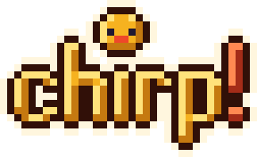
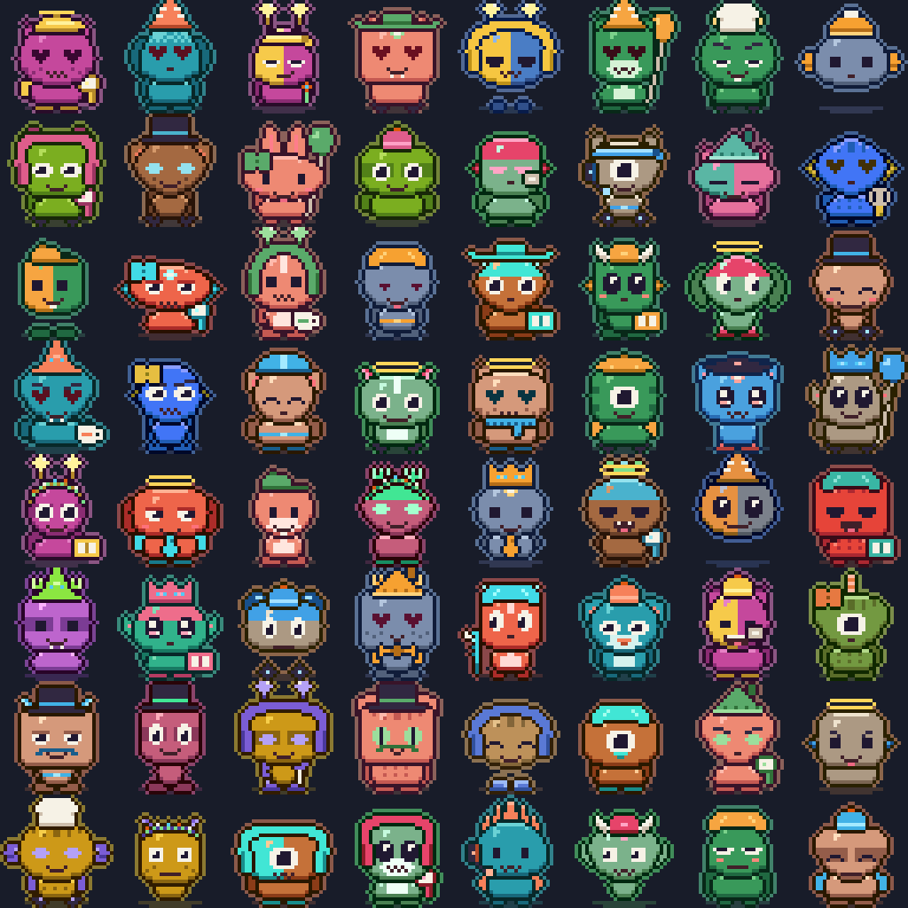
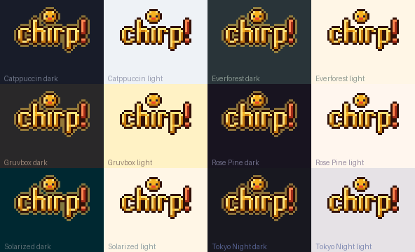

<p align="center"></p>

# chirp! A pocket voice companion

Hold the talk key and ask a question out loud. chirp sends the question to an
AI and speaks the answer. A small pixel character, the Chirper, shows what
happens: it listens, it thinks, it talks. The words show on the screen too.

| You talk | It thinks | The answer starts | It speaks |
|:-:|:-:|:-:|:-:|
|  |  |  |  |

chirp runs on two small handheld devices from LilyGO: the
[T-Embed CC1101 Plus](https://lilygo.cc/products/t-embed-cc1101-plus) (a dial
and two keys) and the [T-Deck](https://lilygo.cc/products/t-deck) (a keyboard
and a trackball). More devices will follow.

## What you can do with it

- **Ask out loud.** A fact, a recipe, a word you cannot spell. The answer
  comes back as speech and as text.
- **Talk hands-free.** Push the talk key two times quickly. chirp listens
  again after each answer.
- **Type.** On the T-Deck, type a question and push **Enter**.
- **Go back to a chat.** With Hermes, the **Chats** tab resumes recent
  conversations.
- **Make it yours.** Pick a Chirper, a theme, a font and a text size. With
  Venice, pick a voice.
- **Set it up from a phone.** You do not need an app. chirp keeps up to 5
  WiFi networks and joins the strongest one in range.

## Meet the Chirpers

Every agent has its own Chirper. chirp draws it from the name of the agent,
so a different name gives a different character. In the **Chirper** tab, turn
the dial to browse more characters and keep the one you like.

<p align="center"></p>

## Pick a theme

Six colour themes, each in dark and light. You can also pick one of four fonts
in three sizes. The screen layout adjusts to every size.

<p align="center"></p>

## Where the answers come from

During setup you pick one of two backends.

| | Easy: Venice | Private: Hermes |
|---|---|---|
| Best for | A quick start with only the device and a phone | Keeping your data at home, and chats you can resume |
| Answers come from | Venice cloud models | Your own [Hermes Agent](https://hermes-agent.nousresearch.com/docs/getting-started/installation) profile |
| Personality | *Chirper*, a friendly companion for children, built into the firmware | The persona of your Hermes agent |
| Speech to text and voice | Venice cloud | Your own computer |
| You need | A Venice account with API credit, and an API key | A Linux computer on the same WiFi that runs Hermes and the chirp speech server |
| Cost | Venice charges credit for each answer | The cost of your Hermes model provider. Speech is free. |
| Your data | Goes to Venice over https | Stays on your network |

## Quick start

### 1. Get the parts

- A [T-Embed CC1101 Plus](https://lilygo.cc/products/t-embed-cc1101-plus) or a
  [T-Deck](https://lilygo.cc/products/t-deck).
- A USB-C cable that carries data. A charge-only cable does not work.
- A phone with a web browser.
- A 2.4 GHz WiFi network. A network with a sign-in page does not work.
- For Venice: an API key from your
  [Venice account](https://docs.venice.ai/guides/getting-started/generating-api-key).
- For Hermes: a Linux computer. See [Hermes setup](docs/setup-hermes.md).
- On your computer: Git and [PlatformIO](https://platformio.org/install/cli)
  (`pip install platformio`). For the T-Embed, you can use the browser
  installer in Chrome or Edge instead. For the T-Deck, also `openocd-esp32`
  from Espressif.

### 2. Install the firmware

Get the code and connect the device with the USB cable.

```sh
git clone <repo-url> chirp-esp32-firmware
cd chirp-esp32-firmware
```

**T-Embed CC1101 Plus:** run this command.

```sh
pio run -d firmware -e t-embed-cc1101 -t upload
```

Always give the device name with `-e`. Without it, PlatformIO installs the
firmware of every device, one after the other. For the browser installer, see
[Installing the firmware](docs/flashing.md).

**T-Deck:** its serial loader does not accept an upload. Build with
`pio run -d firmware -e t-deck`, then flash over its USB-JTAG port with
OpenOCD. Follow [T-Deck over USB-JTAG](docs/flashing.md#t-deck-over-usb-jtag).

### 3. Set up the device from your phone

A device without settings starts its own WiFi network. The screen shows the
network name (`Chirp-XXXX`), a password and a QR code.

1. Scan the QR code with the phone, or type the password. The phone connects
   to `Chirp-XXXX`.
2. Wait for the setup page to open. If it does not open, go to any `http://`
   address in the browser.
3. Select your WiFi network and type its password.
4. Select **Venice** and type your API key. Or select **Hermes on my network**.
5. Tap **Save and restart**.

The device restarts. When the chat screen shows the talk hint, the device is
ready.

For Hermes, first run `host/setup.sh` and `host/pair.py` on the Hermes
computer. See [Hermes setup](docs/setup-hermes.md). For more about Venice, see
[Venice setup](docs/setup-venice.md).

### 4. Talk

Hold the talk key and speak. Release the key. The device speaks the answer.

## Controls

T-Embed CC1101 Plus:

| To do this | Do this |
|---|---|
| Ask a question | Hold the dial key and speak. Release the key. |
| Stop the answer | Push the dial key. |
| Start or stop hands-free mode | Push the dial key two times quickly. |
| Open the menu or go to the next tab | Push the side key. Push it 5 times to go to **Setup**. |
| Select or scroll | Turn the dial. |
| Use the selected item | Push the dial key. |
| Change the volume (0-21) | Hold the side key for 1.5 seconds. Then turn the dial. |

T-Deck:

| To do this | Do this |
|---|---|
| Ask a question | Hold the mic key and speak. Release the key. |
| Type a question | Type it. Then push **Enter**. |
| Stop the answer | Push the mic key. |
| Start or stop hands-free mode | Push the mic key two times quickly. |
| Open the menu or go to the next tab | Click the trackball. Click it 5 times to go to **Setup**. |
| Close the menu | Push **Backspace**. |
| Select or scroll | Roll the trackball up or down. |
| Use the selected item | Push **Enter**. |
| Change the volume (0-21) | Hold the trackball click. Then roll the trackball. |

All controls and screens are in [Using chirp](docs/using.md).

## Help

| Problem | What to do |
|---|---|
| The computer does not find the device | Use a data cable. T-Embed: hold **BOOT** when you connect the cable. T-Deck: check the udev rule in [T-Deck over USB-JTAG](docs/flashing.md#t-deck-over-usb-jtag). |
| The phone does not show `Chirp-XXXX` | Read the name and the password on the device screen. Use 2.4 GHz. Move the phone nearer. |
| The phone says "no internet" | Stay connected. The setup network has no internet. |
| The setup page does not open | Go to any `http://` address. Do not use `https://`. |
| The device shows "WiFi failed" | Check the password. Use a 2.4 GHz network. Go to **Setup**, select **Set up on phone**, and add or correct the network. |
| Venice: "Bad API key" or "Out of credit" | Type the key again on the setup page, or add credit to your Venice account. |
| Hermes: "unreachable" or "key rejected" | Run `python3 host/pair.py` again. It checks all connections. |

More problems and their solutions are in [Troubleshooting](docs/troubleshooting.md).

## More information

- [Installing the firmware](docs/flashing.md)
- [First setup on the phone](docs/first-setup.md)
- [Venice setup](docs/setup-venice.md) and [Hermes setup](docs/setup-hermes.md)
- [Using chirp](docs/using.md)
- [How a question is answered](docs/how-it-works.md)
- [Troubleshooting and known limits](docs/troubleshooting.md)
- [Updating](docs/updating.md)
- [Security notes](docs/security.md) and [how to report a problem](SECURITY.md)
- [Contributing](CONTRIBUTING.md)
- [Development](docs/development.md)
- [Changelog](CHANGELOG.md)

## License

chirp is free software under the
[GNU General Public License, version 3 only](LICENSE) (GPL-3.0-only). You can
use, change and share it. If you give someone a chirp firmware image or a
device that runs it, you must also give them the matching source code under the
same license.

Parts by others keep their own licenses:

- The four fonts (Atkinson Hyperlegible, Inter, Paper Mono and Terminus) use the
  SIL Open Font License 1.1. Each license file is next to the font data in
  [`firmware/src/fonts/`](firmware/src/fonts).
- [`firmware/lib/ESP32-audioI2S`](firmware/lib/ESP32-audioI2S) uses the GPL-3.0.
- [ESP Web Tools](flasher/esp-web-tools) in the browser installer uses the
  Apache License 2.0.
