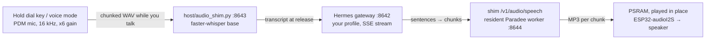

# How a turn works

## Hermes route

- **Speech recognition starts before you let go.** The capture streams to the
  speech server while you talk; whisper re-decodes the growing buffer in the
  background, so the final transcript is ready about a second after release.
  If the stream drops, the device falls back to one upload.
- **Speech starts on the first sentence.** The answer streams from Hermes; the
  first sentence becomes the first chunk, the second chunk stays short (2+
  sentences / 14+ words, closed at 30 words), later chunks grow (30+ words, 80
  max), and playback begins while Hermes is still generating. A chunk closes
  at the sentence where it is complete, so a burst of text never becomes one
  huge chunk. Audio typically starts about 1 s after Hermes' first word.
- **The voice is local and warm.** [Paradee](https://github.com/sahilmahendrakar/paradee)
  (8M-parameter distillation of Kokoro-82M, single voice `af_heart`) stays
  loaded in a resident worker: about 0.2 s per chunk.

## Venice route

The device calls Venice directly over HTTPS for each of the three steps:
speech-to-text (Parakeet), the answer (a Venice-hosted chat model; the last 12
exchanges ride along on each request, since Venice keeps no state) and the
voice (Kokoro: Sky, Heart or Bella). There is no speech server, no gateway and
no computer in the path. The model ids are pinned in
`firmware/include/venice_policy.h` per firmware release.

## The speech server's limits

The speech server listens on your network and bounds every request: a
recording body is capped (30 s of audio plus slack, 64 KB per chunk), speech
input at 4096 characters, any socket read or write times out after 30 s, a
whole body must arrive within 60 s, and at most four POSTs run at once (the
rest get 503).
