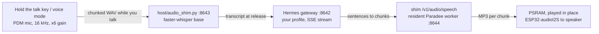

# How a turn works

A turn is one question and its spoken answer.

## Hermes route

### Speech recognition starts before you release the talk key

The device streams the recording to the speech server while you talk. whisper decodes the growing buffer again in the background. The final transcript is ready about one second after you release the key. If the stream drops, the device uploads the recording in one piece.

### Speech starts at the first sentence

The answer streams from Hermes. The device plays it in chunks:

- The first sentence becomes the first chunk.
- The second chunk stays short. It closes at 2 or more sentences or 14 or more words. It closes at 30 words at the latest.
- Later chunks are longer. They need 30 or more words and have 80 words at the most.

A chunk closes at the sentence where it is complete. A burst of text never becomes one huge chunk. Playback starts while Hermes is still generating. Audio usually starts about 1 s after the first word from Hermes.

### The voice is local

[Paradee](https://github.com/sahilmahendrakar/paradee) is a distillation of Kokoro-82M with 8M parameters. It has one voice, `af_heart`. It stays loaded in a resident worker. Each chunk takes about 0.2 s.

## Venice route

The device calls Venice directly over HTTPS for each of the three steps:

1. Speech-to-text (Parakeet).
2. The answer. A Venice-hosted chat model writes it. Venice keeps no state, so the device sends the last 12 exchanges with each request.
3. The voice (Kokoro: Sky, Heart or Bella).

The path has no speech server, no gateway and no computer. `firmware/include/venice_policy.h` pins the model ids for each firmware release.

## Limits of the speech server

The speech server listens on your network and sets a limit on every request:

- A recording body has a limit of 30 s of audio plus slack, and 64 KB for each chunk.
- Speech input has a limit of 4096 characters.
- A socket read or write times out after 30 s.
- A whole body must arrive within 60 s.
- At most four POSTs run at the same time. The server answers the others with 503.
